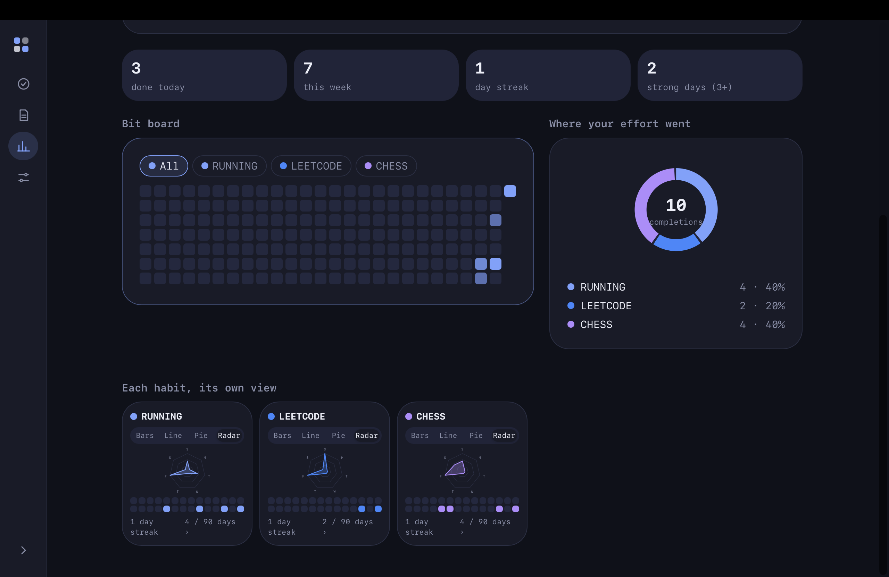
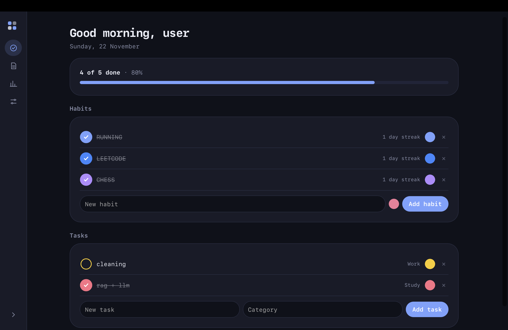
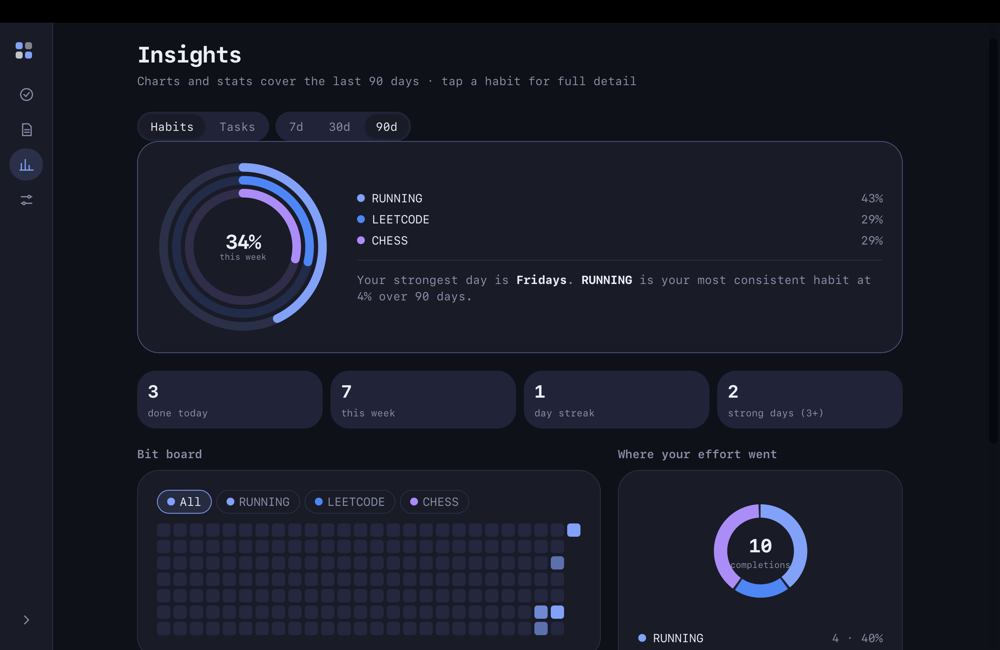
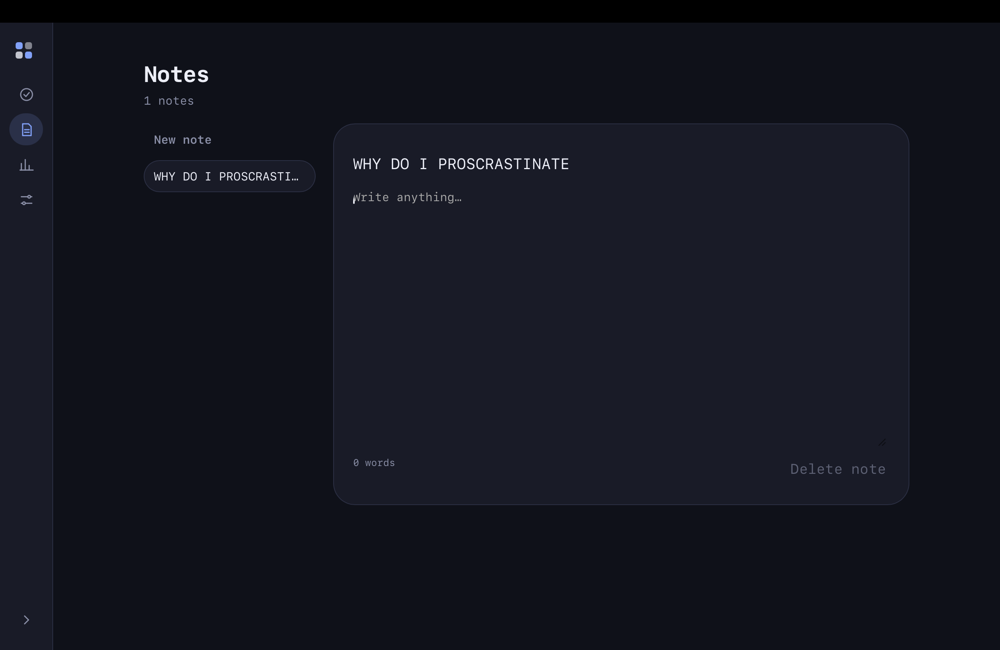
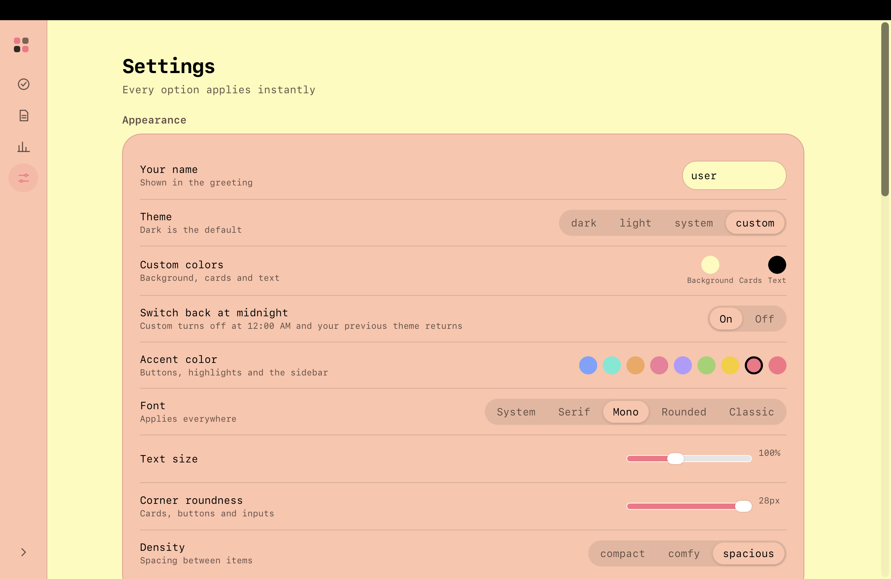
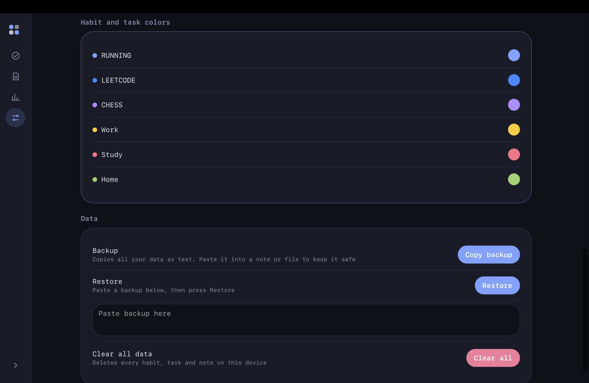
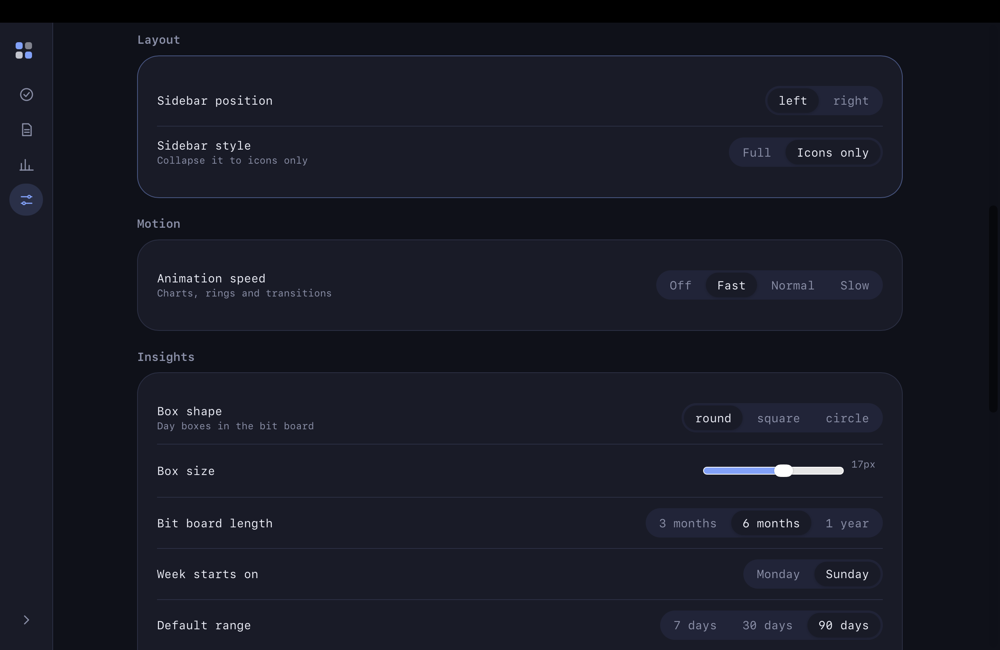
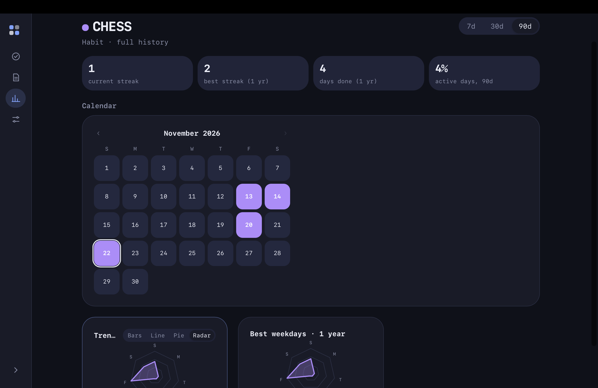
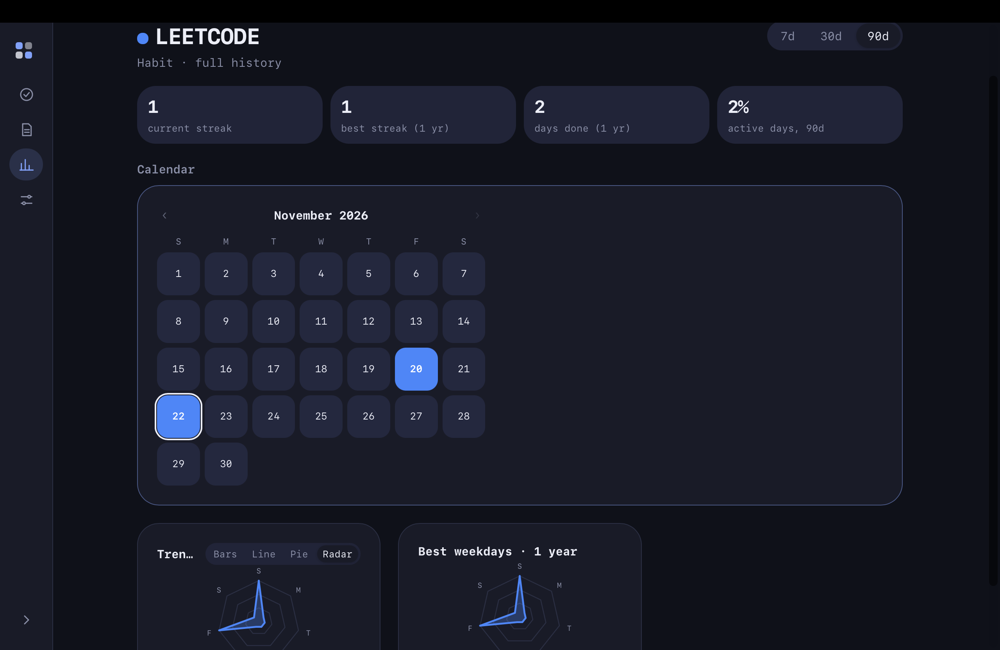
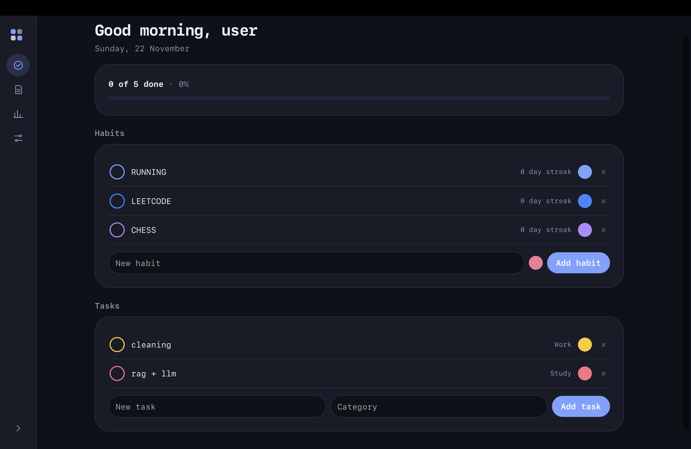

# Lockbits 0.2.2

### LOCKin your haBITS.

Lockbits is a simple productivity application that brings habits, tasks, notes and productivity insights together in one place.

The goal is to make everyday organization easier without unnecessary complexity.

## About

Lockbits is built using Tauri 2 and uses a single interface file, `ui/index.html`, for its application interface.

It is designed to help you organize your daily routine, track habits, manage tasks, keep notes and personalize your workspace.

Your habits and notes are stored locally on your device.

## Features

### Habit Tracking

Create and manage your daily habits and keep track of your consistency.

### Task Management

Organize your tasks and keep track of what you need to complete.

### Notes

Keep your notes and important information organized in one place.

### Insights

View your productivity information and get an overview of your progress.

### Themes and Customization

Personalize the appearance of your workspace using the available theme and customization options.

## Technology Stack

- Tauri 2
- Rust
- JavaScript
- HTML
- CSS
- npm

## Installation and Setup

You can run Lockbits locally by cloning this repository and installing its dependencies.

### Requirements

Before starting, make sure you have:

- Node.js installed
- npm installed (included with Node.js)
- Rust installed
- The development tools required for your operating system and Tauri

### 1. Clone the Repository

Open your terminal and run:

```bash
git clone https://github.com/h3mill/lockbits.git
```

Move into the project directory:

```bash
cd lockbits
```

### 2. Install Dependencies

Run:

```bash
npm install
```

This installs the dependencies required by the project.

### 3. Prepare Application Icons

The repository includes `app-icon.png`.

If the Tauri icon folder is missing or needs to be generated, run:

```bash
npx tauri icon app-icon.png
```

This step is only needed when the required application icons have not already been generated.

### 4. Run Lockbits in Development Mode

Run:

```bash
npm run dev
```

This starts the Tauri development application.

If you make changes to `ui/index.html`, reload the application to see them.

On macOS, you can use `Cmd + R` to reload.

### 5. Build the Application

When you want to create a production build, run:

```bash
npm run build
```

On macOS, the generated DMG installer is located at:

```text
src-tauri/target/release/bundle/dmg/
```

## Platform Instructions

Lockbits uses Tauri 2 and has platform-specific development workflows.

### macOS

Install Node.js, Rust and the required macOS development tools.

Follow the installation instructions above.

### Windows

Install Node.js, Rust and the required Windows development tools.

After installing the project dependencies, run:

```bash
npm run build
```

Run the build on a Windows computer to generate the Windows application installer.

### iOS

You need macOS and Xcode installed.

Initialize the iOS project:

```bash
npm run tauri ios init
```

Run the development application:

```bash
npm run tauri ios dev
```

### Android

Install Android Studio and the required Android development tools.

Initialize the Android project:

```bash
npm run tauri android init
```

Run the development application:

```bash
npm run tauri android dev
```

Platform-specific setup and configuration may be required before building.

## Updating an Existing Installation

If you already have Lockbits installed, you can build the updated version and install it over your existing installation.

The application ID is:

```text
com.lockbits.app
```

This ID has not changed between the versions described in this project.

Your existing habits and notes are tied to the application ID, so keeping it unchanged is important when updating.

## Project Structure

A quick overview of the repository:

```text
lockbits/
├── screenshots/     # Application screenshots
├── src-tauri/       # Tauri and Rust application files
├── ui/              # Application interface
│   └── index.html   # Main interface
├── app-icon.png     # Application icon source
├── package.json     # Project configuration and scripts
└── README.md        # Project documentation
```

## Feedback and Contributions

Feedback and suggestions are welcome.

If you encounter a problem, have a suggestion or find something that could be improved, you can open an issue in this repository.

Your feedback helps make Lockbits better.

## Repository

GitHub: https://github.com/h3mill/lockbits


## Screenshots

Explore the Lockbits interface and its features.

### Dashboard



### Habits



### Insights



### Settings


### Notes



### Customization



### Additional Screens













